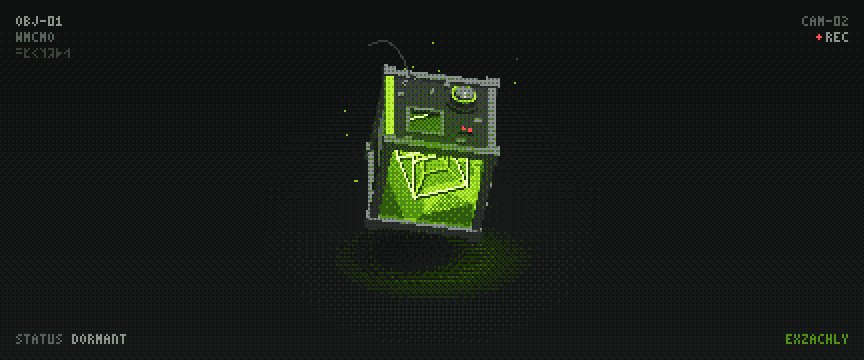

  

### It's me, Zach 😎

I build small tools that do one job well: mostly for learning Japanese, staying focused, and reading my own notes. Everything here is free and open source, and most of it runs in the browser with nothing to install.

### 🇯🇵 Learning Japanese

| | |
|---|---|
| **[hashigo](https://github.com/wmCmo/hashigo)** · [open ↗](https://wmcmo.github.io/hashigo/) | 梯子: local-first spaced repetition for Japanese |
| **[jisho-slide](https://github.com/wmCmo/jisho-slide)** · [open ↗](https://wmcmo.github.io/jisho-slide/) | A minimal slideshow of JLPT words to let them wash over you |
| **[tutor-suzukisan](https://github.com/wmCmo/tutor-suzukisan)** · [open ↗](https://wmcmo.github.io/tutor-suzukisan/) | A cleaner front end for OJAD's pitch-accent tutor (スズキクン) |
| **[mochi-numbers](https://github.com/wmCmo/mochi-numbers)** | Generate random number cards in Mochi through its API |

### ⏱️ Focus and habits

| | |
|---|---|
| **[so-tired-of-scrolling](https://github.com/wmCmo/so-tired-of-scrolling)** · [site ↗](https://wmcmo.github.io/so-tired-of-scrolling/) | Browser extension that puts a pause in front of YouTube Shorts and Instagram Reels |
| **[tomato](https://github.com/wmCmo/tomato)** · [open ↗](https://wmcmo.github.io/tomato/) | Minimal, responsive Pomodoro timer |
| **[training-timer](https://github.com/wmCmo/training-timer)** · [open ↗](https://wmcmo.github.io/training-timer/) | Interval timer for workouts, with a local record log |

### 🗂️ Notes and forms

| | |
|---|---|
| **[vault-reader](https://github.com/wmCmo/vault-reader)** · [open ↗](https://wmcmo.github.io/vault-reader/) | Read your Obsidian vault on your phone, offline, served from your own PC over Tailscale |
| **[suisei](https://github.com/wmCmo/suisei)** · [open ↗](https://wmcmo.github.io/suisei/) | 水星: a form builder you write like a document, in one HTML file |

### 🛠️ Developer and AI tools

| | |
|---|---|
| **[claude-mods](https://github.com/wmCmo/claude-mods)** | Claude Code plugins: a context and weekly-limit bar, and `/compact-pickup` |
| **[ai-distill](https://github.com/wmCmo/ai-distill)** | Turn Notion's block JSON into LLM-friendly Markdown |
| **[ats-resume-checker](https://github.com/wmCmo/ats-resume-checker)** | NLP pipeline that masks personal information in résumés and scores them the way an ATS would |
| **[fishtest-tv](https://github.com/wmCmo/fishtest-tv)** | Dashboard, across-the-room TV with AI commentary, and a phone remote for a Stockfish Fishtest worker |

### 🧬 Experiments

| | |
|---|---|
| **[Life Engine Lab](https://github.com/wmCmo/LifeEngine/tree/perf/sim-worker)** · [open ↗](https://wmcmo.github.io/LifeEngine/) | Is evolution going in circles? A 10–20× faster rebuild of Max Robinson's [The Life Engine](https://github.com/MaxRobinsonTheGreat/LifeEngine), with real species, a growing family tree and 12 worlds side by side |

### 🎲 Just for fun

| | |
|---|---|
| **[kyoto-gate](https://github.com/wmCmo/kyoto-gate)** · [download ↗](https://github.com/wmCmo/kyoto-gate/releases/latest) | Minecraft data pack: plant one torii and a Kyoto town grows across the terrain |
| **[Untimed-Scrambler](https://github.com/wmCmo/Untimed-Scrambler)** · [open ↗](https://wmcmo.github.io/Untimed-Scrambler/) | A calm Rubik's cube scrambler, no timer |

---

🌐 [exzachly.vercel.app](https://exzachly.vercel.app) · Digital Business & Innovation
